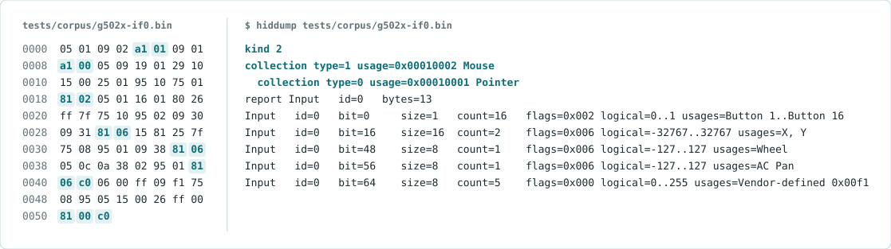

# hid-parser

Parse HID report descriptors and read or build HID reports. It follows the rules of the
Linux kernel parser, so a descriptor means here what it means to the kernel, and works on any
system with a C99 compiler.

- tokenizer: walks the items of a descriptor through a callback, without allocating
- parser: a flat list of fields per report (type, report ID, bit offset, size, count, flags,
  logical and physical range, unit, usages), the collection tree and the size of every report
- three modes: kernel rules (default), `HIDP_PARSE_STRICT` and `HIDP_PARSE_TOLERANT`, which
  keeps going on the broken descriptors of real devices and records each problem as a warning
  with its byte offset
- values: read and write any field of up to 32 bits as `int64_t`, signed when the logical
  minimum is negative, so unsigned 32-bit fields keep their whole range; map array values to usages; check null state with `hidp_field_in_range`
- `hidp_desc_application`: the top-level application collection a field or collection belongs
  to, to split composite devices such as a keyboard with media keys
- classification of devices (`hidp_desc_kind`) and usages (`hidp_usage_role`: button, axis,
  hat, key, LED, haptic)
- usage names from the HID Usage Tables 1.7, in their own object file so a static link only
  pulls them in when you call `hidp_usage_name`, `hidp_usage_page_name` or `hidp_usage_print`

## Quick look

<picture>
  <source media="(prefers-color-scheme: dark)" srcset="docs/images/descriptor-dark.svg">
  
</picture>

## Build and install

```sh
cmake -S . -B build -DBUILD_SHARED_LIBS=ON
cmake --build build
cmake --install build --prefix /usr/local
```

Use it from CMake:

```cmake
find_package(hid-parser REQUIRED)
target_link_libraries(app PRIVATE hid-parser::hid-parser)
```

Or with pkg-config:

```sh
cc app.c $(pkg-config --cflags --libs hid-parser)
```

## Single-file form

`scripts/amalgamate.sh` writes `dist/hid-parser/hid-parser.h`. Copy it into your project and, in
exactly one `.c` file:

```c
#define HIDP_IMPLEMENTATION
#include "hid-parser/hid-parser.h"
```

Define `HIDP_STATIC` as well to keep every function private to that file.

## Usage

```c
hidp_desc_t *desc;
size_t err;
int status = hidp_desc_parse(bytes, len, NULL, &desc, &err);

if (status != HIDP_OK) {
    fprintf(stderr, "byte %zu: %s\n", err, hidp_strerror(status));
    return 1;
}

size_t field, index;
int64_t x;

if (hidp_desc_find_usage(desc, HIDP_INPUT, 0x00010030, 0, &field, &index) == HIDP_OK
    && hidp_field_read(hidp_desc_field(desc, field), report, report_len, index, &x) == HIDP_OK)
    printf("X = %lld\n", (long long)x);
hidp_desc_destroy(desc);
```

To read a whole report, `hidp_report_decode` calls you back with the usage and value of each
variable control and of each usage present in an array; fields wider than 32 bits are left
out.

To build a descriptor, `hidp_item_write` encodes one short item in the smallest size that
keeps its value, reading Logical/Physical Minimum and Maximum and Unit Exponent as signed.

To send a report, find it with `hidp_desc_find_report`, clear it with `hidp_report_init` (which
also writes the report ID) and fill it with `hidp_field_write`.

[`examples/hiddump.c`](examples/hiddump.c) prints a descriptor as an item tree (`--items`), as
reports and fields, or as one line per value (`--slots`); `--hex` reads hex text instead of
binary, and `--report` decodes one input report given in hex:

```sh
hiddump /sys/class/hidraw/hidraw0/device/report_descriptor
hiddump --report "05 00 fd ff 03 00 01 ff 00 00 00 00 00" mouse.bin
```

The header `include/hid-parser/hid-parser.h` is the API reference.

Conventions:

- every function that can fail returns `HIDP_OK` or an error code; `hidp_strerror` describes it
- what `hidp_desc_parse` returns is released only by `hidp_desc_destroy`, which accepts `NULL`
- fields, collections, reports and warnings belong to the descriptor and live until it is
  destroyed
- `hidp_desc_parse` takes a `hidp_parse_options_t` with the mode flags and an optional
  allocator (`alloc_fn` and `free_fn`, both set or both `NULL` for `malloc`/`free`); `NULL`
  options mean the default mode with `malloc`
- usages are 32-bit extended values, usage page in the high 16 bits
- `bit_offset` counts from the start of the report, report ID byte included
- a parsed descriptor is never modified, so any number of threads may read it at once; the
  library has no global state

## Rules

The default mode does what `drivers/hid/hid-core.c` does:

- short usages take the usage page that is current at the main item, walking back until one
  already has it; Usage Minimum/Maximum expand at the maximum, capped at 12288 usages with the
  same 32-bit arithmetic as the kernel, so a maximum below the minimum fills the table from the
  minimum on
- Logical and Physical Maximum are read as signed only when the minimum is negative
- a 4-bit Unit Exponent is sign-extended
- report ID is a global item and follows Push/Pop; the global stack holds 4 entries
- only the first branch of a delimiter set is used; nested delimiters are an error
- a collection takes its first usage
- errors: long items, unknown global items, report size above 256, report count above
  12288, report ID 0 or above 255, logical minimum above maximum, reports longer than 16383
  bytes, unbalanced collections or delimiters, truncated items, empty descriptors
- unknown main items are warnings; unknown local items and reserved item types are ignored

Unlike the kernel, padding fields without usages are kept, so every bit of a report belongs to
a field.

`HIDP_PARSE_STRICT` also rejects Usage Maximum without Usage Minimum or below it, a Usage
Minimum left without its maximum, a maximum that only fits when read as signed, and a
descriptor that mixes reports with and without ID.

`HIDP_PARSE_TOLERANT` turns the recoverable errors into warnings: it skips long and unknown
items, accepts report sizes and counts up to 65535, ignores bad report IDs and logical ranges,
allows 64 nested Push and closes what is left open.

## Validation

- `tests/corpus`: descriptors of real devices with the expected output, checked by `ctest`
- `tests/oracle/compare.py`: compares every field with the `hid-decode` parser of hid-tools;
  `scripts/fetch-corpus.sh` gathers the descriptors of the Linux and hid-tools test suites
  (GPL, so they stay out of this repository). All of them match, apart from one documented
  hid-tools difference: it ignores Usage Maximum without Usage Minimum
- `tests/kernel-oracle`: compares every field with the dump of the kernel parser
  (`/sys/kernel/debug/hid/*/rdesc`); `vm/run-vm.sh` boots a stock kernel in QEMU and feeds the
  descriptors through uhid, so no debugfs is needed on the host
- `fuzz/fuzz_parse.c`: parses in the three modes and reads and writes every field
- tests also pass on 32-bit x86 and on Windows (mingw)

## Versioning

Semantic Versioning, from 1.0.0 on. Within a major version the API and ABI only grow: nothing
is removed or changes meaning, and the public structs keep their layout. What is going away is
marked deprecated in a minor release first. Incompatible releases bump the major version and
the soname. See [CHANGELOG.md](CHANGELOG.md).

## License

MIT, see [LICENSE](LICENSE). The usage names are generated from the HID Usage Tables published
by the USB Implementers Forum.
